# 🌡️ Smart HVAC Thermal Control, Hardware-in-the-Loop & Fault Detection System

[](https://www.mathworks.com/products/matlab.html)
[](https://www.mathworks.com/products/simulink.html)
[](https://www.arduino.cc/)
[](https://www.quanser.com/)
[](#-executive-summary)

> **Course:** EE302 Control Systems Laboratory — Problem Statement 4 (Group 7)  
> **Institution:** School of Computing and Electrical Engineering, Indian Institute of Technology (IIT) Mandi  
> **Course Instructor:** Dr. Yanumula Venkata Karteek  
> **Authors:** Jigar Fufal (B24244), Rathod Dhruv Shailesh (B24242), Dumpa Mohan Sai (B24243), Geetanjali Saraswat (B24245)  
> **Core Deliverables:** Software Simulation, Quanser QNET Industrial HIL Benchmark, Custom 3D-Printed Hardware Chamber Implementation.

---

## 📑 Table of Contents

1. [Executive Summary & Three-Pillar Architecture](#-executive-summary--three-pillar-architecture)
2. [Pillar 1: Pure Software Simulink Simulation (`simulink/`)](#1️⃣-pillar-1-pure-software-simulink-simulation-simulink)
3. [Pillar 2: Quanser QNET HVAC NI ELVIS II+ Pipeline (`qnet_hvac_ni_elvis/`)](#2️⃣-pillar-2-quanser-qnet-hvac-ni-elvis-ii-pipeline-qnet_hvac_ni_elvis)
4. [Pillar 3: Custom 3D-Printed Hardware Implementation (`custom_hardware/`)](#3️⃣-pillar-3-custom-3d-printed-hardware-implementation-custom_hardware)
5. [Comparative Quantitative Performance](#-comparative-quantitative-performance)
6. [Repository Structure](#-repository-structure)
7. [Reproduction & Execution Guide](#-reproduction--execution-guide)
8. [Comprehensive Documentation & Reports](#-comprehensive-documentation--reports)
9. [Author & Course Information](#-author--course-information)

---

## 📋 Executive Summary & Three-Pillar Architecture

This repository contains the complete, production-grade control engineering implementation for temperature regulation, disturbance rejection, and real-time Fault Detection & Isolation (FDI) in smart HVAC thermal chambers.

To ensure exhaustive theoretical modeling, industrial benchmark validation, and practical physical verification, the project is structured into **three distinct pillars**:

```mermaid
flowchart TD
    subgraph P1 ["Pillar 1: Software Simulation (simulink/)"]
        S1["First-Principles Energy Balance ODE"] --> S2["FOPTD Transfer Function G(s)"]
        S2 --> S3["Simulink Dynamic Model (thermal_control.slx)"]
        S3 --> S4["Comparative Evaluation: ON-OFF Relay vs Anti-Windup PI"]
    end

    subgraph P2 ["Pillar 2: Quanser QNET Industrial HIL (qnet_hvac_ni_elvis/)"]
        Q1["NI ELVIS II+ DAQ Workstation (Dev1)"] --> Q2["Quanser QNET HVAC Duct (QNET-012)"]
        Q2 --> Q3["Real-Time Hardware or Digital Twin Emulation"]
        Q3 --> Q4["Luenberger State Observer FDI & IEEE Technical Paper"]
    end

    subgraph P3 ["Pillar 3: Custom Physical Hardware (custom_hardware/)"]
        H1["3D-Printed Insulated Duct + Removable Hatch"] --> H2["Arduino Mega 2560 + Active-LOW Opto-Relays"]
        H2 --> H3["14.0W Nichrome Heater, 0.51W Fan, LM35 Sensor"]
        H3 --> H4["In-Situ Z-N Auto-Tuning, Contact Dwell & 4-Code FDI Machine"]
    end
```



| Project Pillar | Target Environment | Primary Purpose | Key Technologies |
| :--- | :--- | :--- | :--- |
| **Pillar 1: Software Simulation** | Simulink / MATLAB base workspace | First-principles physics modeling, continuous-time controller synthesis, and baseline multi-step tracking. | MATLAB R2026a, Simulink, Control System Toolbox |
| **Pillar 2: Quanser QNET HVAC** | NI ELVIS II+ Multifunction DAQ & Quanser Trainer | Industrial benchmark validation, Dual-sensor Luenberger observer FDI, Digital Twin mode, IEEE paper. | Data Acquisition Toolbox, NI-DAQmx, Quanser QNET |
| **Pillar 3: Custom Hardware** | Custom 3D-printed chamber, Arduino Mega | Physical prototype validation, discrete relay dwell protection, physical hatch disturbance, Åström-Hägglund Z-N tuning. | Arduino C++, MATLAB Serial Interface, Simscape |

---

## 1️⃣ Pillar 1: Pure Software Simulink Simulation (`simulink/`)

The [`simulink/`](simulink/) folder hosts the pure simulation environment, modeling thermal dynamics from first-principles heat transfer equations.

### Plant Mathematical Formulation
The thermal chamber temperature $T(t)$ is governed by:

$$C_\text{th} \frac{dT(t)}{dt} = P \cdot u(t - L) - \frac{T(t) - T_\text{amb}}{R_\text{th}}$$

Where:
- $C_\text{th} = 400.0\text{ J/}^\circ\text{C}$ (Thermal capacitance of air mass)
- $R_\text{th} = 0.3000^\circ\text{C/W}$ (Thermal resistance to ambient)
- $P = 50.0\text{ W}$ (Rated heater input power)
- $u(t) \in [0, 1]$ (Normalized control effort)
- $L = 3.0\text{ s}$ (Transport delay and probe lag)
- $T_\text{amb} = 25.0^\circ\text{C}$ (Ambient temperature)

### First-Order Plus Dead Time (FOPTD) Model:
$$G(s) = \frac{\Delta T(s)}{\Delta u(s)} = \frac{15.00 e^{-3s}}{120s + 1}$$

### Controllers Evaluated:
1. **Hysteresis Bang-Bang Relay:** Deadband $\pm 0.5^\circ\text{C}$ to suppress relay chatter while regulating around the setpoint.
2. **Anti-Windup PI Controller (IMC Tuned):** Synthesized for closed-loop time constant $\tau_c = 12.0\text{ s}$:
   $$K_p = \frac{\tau}{K(\tau_c + L)} = 0.5333, \quad K_i = \frac{K_p}{\tau} = 0.00444\text{ s}^{-1}$$
   - Includes conditional integrator clamping to eliminate reset windup during actuator saturation $[0.0, 1.0]$.
3. **Disturbance Recovery:** Evaluation against a $+30\%$ thermal resistance step ($R_\text{th} \to 0.39^\circ\text{C/W}$) at $t = 900\text{ s}$.

### Key Files in [`simulink/`](simulink/):
- [`init_params.m`](simulink/init_params.m): Initializes workspace physical parameters, controller gains, and disturbance times.
- [`build_model.m`](simulink/build_model.m): Programmatic generator for [`thermal_control.slx`](simulink/thermal_control.slx).
- [`run_simulation.m`](simulink/run_simulation.m): Automated simulation pipeline running ON-OFF, PI, and Disturbance scenarios, generating high-resolution figures.
- [`tune_pi.m`](simulink/tune_pi.m): IMC and Ziegler-Nichols tuning evaluation.
- [`compute_metrics.m`](simulink/compute_metrics.m): Rise time, settling time, overshoot, steady-state error, and cumulative energy calculator.
- [`plot_onoff_vs_pi.png`](simulink/plot_onoff_vs_pi.png) & [`plot_pi_disturbance.png`](simulink/plot_pi_disturbance.png): Publication response curves.

---

## 2️⃣ Pillar 2: Quanser QNET HVAC NI ELVIS II+ Pipeline (`qnet_hvac_ni_elvis/`)

The [`qnet_hvac_ni_elvis/`](qnet_hvac_ni_elvis/) folder contains the laboratory-verified industrial hardware pipeline designed for the **Quanser QNET HVAC Trainer 1.0** mounted on a **National Instruments NI ELVIS II+** DAQ workstation.

### Key Capabilities:
- **Dual Operating Modes:** Automated detection of NI ELVIS II+ hardware via NI-DAQmx (`Dev1`). If disconnected, the pipeline automatically activates the **Digital Twin Emulation Mode**, enabling full test suite execution without physical hardware.
- **Model-Based Fault Detection & Isolation (FDI):** Real-time continuous-discrete Luenberger state observer tracking chamber temperature residuals:
  $$r(t) = T_\text{meas}(t) - \hat{T}(t)$$
  Detects and flags **fan stall / duct blockage** ($|r(t)| > 3.0^\circ\text{C}$), **sensor disagreement** ($|T_1 - T_2| > 2.0^\circ\text{C}$), and **emergency over-temperature cutoff** ($T > 55.0^\circ\text{C}$).
- **Energy Optimization:** The IMC PI controller achieves a **10.6% energy reduction** over traditional ON-OFF control while driving steady-state error below $0.1^\circ\text{C}$.
- **IEEE Technical Publication:** Includes a full IEEE-format conference/journal paper with LaTeX source, figures, and compiled PDF.

### Key Files in [`qnet_hvac_ni_elvis/`](qnet_hvac_ni_elvis/):
- [`main_run_all.m`](qnet_hvac_ni_elvis/main_run_all.m): Master automated pipeline running identification, controller runs, metrics calculation, and figure generation.
- [`config/`](qnet_hvac_ni_elvis/config/): Physical constants, DAQ channel maps, and controller tuning parameters.
- [`controllers/`](qnet_hvac_ni_elvis/controllers/): Modular MATLAB controller implementations (`onoff_controller.m`, `pi_controller.m`, `fault_detector.m`).
- [`models/qnet_hvac_simulink.slx`](qnet_hvac_ni_elvis/models/qnet_hvac_simulink.slx): Full closed-loop Simulink model with observer and fault logic.
- [`tests/test_qnet_system.m`](qnet_hvac_ni_elvis/tests/test_qnet_system.m): Comprehensive MATLAB unit test suite covering plant physics, controller stability, and observer convergence (7 test methods).
- [`report/IEEE_Report_Smart_HVAC_Control.pdf`](qnet_hvac_ni_elvis/report/IEEE_Report_Smart_HVAC_Control.pdf): Complete IEEE technical paper report.
- [`results/controller_comparison_table.csv`](qnet_hvac_ni_elvis/results/controller_comparison_table.csv): Exact quantified multi-step metrics.

---

## 3️⃣ Pillar 3: Custom 3D-Printed Hardware Implementation (`custom_hardware/`)

The [`custom_hardware/`](custom_hardware/) folder encapsulates the physical, custom-engineered laboratory prototype built from the ground up using 3D-printed modular components and an **Arduino Mega 2560** microcontroller.

### Physical Chamber Specifications:
- **3D-Printed Cylindrical Duct:** Polymer housing with axial forced-air inlet flange and slotted exhaust baffle.
- **Removable Curved Insulation Hatch:** Hand-operated access panel enabling physical, repeatable convective heat-loss disturbance testing.
- **Heater Actuator:** 14.00 W nichrome heating coil ($8.0\text{ V}, 1.75\text{ A}, R = 4.57\ \Omega$) switched via an active-LOW opto-isolated relay on pin `D6`.
- **Cooling Fan Actuator:** 0.51 W DC brushless axial fan ($3.0\text{ V}, 0.17\text{ A}$) switched via an active-LOW relay on pin `D9`.
- **Temperature Sensing:** Precision LM35 analog temperature sensor ($10\text{ mV/}^\circ\text{C}$) sampled through `A1` via moving-average noise filtering.

### Control Engineering Innovations:
- **Ziegler–Nichols Relay Auto-Tuning:** In-situ Åström–Hägglund sustained oscillation test at $35.0^\circ\text{C}$ extracted ultimate gain $K_u = 0.9817$ and ultimate period $P_u = 53.50\text{ s}$, yielding tuned PI gains ($K_p = 0.4418, K_i = 0.00991\text{ s}^{-1}$).
- **Contact Dwell Time & Deadband Mapping:** Implements mandatory $2.0\text{ s}$ relay contact dwell protection and a $5\%$ PWM deadband to eliminate mechanical wear on electromagnetic relay armatures.
- **Four-Code Diagnostic State Machine:** Deterministic real-time fault detection classifying **Hatch Removal** (Code 1), **Heater Open-Circuit** (Code 2), **Fan Stall** (Code 3), and **Sensor Disconnect/Spike** (Code 4).
- **Frequency-Domain Identification & Stability:** Experimental FOPDT transfer function derived from physical step data:
  $$G_A(s) = \frac{16.65}{138.96s + 1} e^{-13.90s}$$
  Yielding verified stability margins of **$\text{Gain Margin} = 5.56\text{ dB}$** and **$\text{Phase Margin} = 30.62^\circ$**.

### Key Files in [`custom_hardware/`](custom_hardware/):
- [`ControlFinalProject.pdf`](custom_hardware/ControlFinalProject.pdf): Complete 8.6 MB final engineering lab report.
- [`Smart_HVAC_System_Analysis_Report.md`](custom_hardware/Smart_HVAC_System_Analysis_Report.md): In-depth 380+ line analytical report detailing all physical hardware runs, equations, and experimental metrics.
- [`OnOffController/OnOffController.m`](custom_hardware/OnOffController/OnOffController.m): Automated discrete hysteresis regulation script with automated settling detection.
- [`PIController/PIController.m`](custom_hardware/PIController/PIController.m): Master discrete anti-windup PI controller with supervisory fan override and FDI state machine.
- [`TransferFunctionAnalysis/PlayingWithTransferFunction.m`](custom_hardware/TransferFunctionAnalysis/PlayingWithTransferFunction.m): MATLAB script computing open-loop and closed-loop transfer functions, Bode plots, Root Locus, and stability margins.
- [`AllImages/`](custom_hardware/AllImages/): 18 high-resolution photos, circuit schematics, hardware wiring diagrams, and oscilloscope/response plots.

---

## 📊 Comparative Quantitative Performance

### 1. Multi-Step Response ($30^\circ\text{C} \to 40^\circ\text{C} \to 35^\circ\text{C}$)

| Performance Metric | ON-OFF Relay (Hysteresis $\pm0.5^\circ\text{C}$) | IMC Anti-Windup PI | Disturbed PI ($+30\% R_\text{th}$) | Engineering Significance |
| :--- | :---: | :---: | :---: | :--- |
| **Rise Time ($10\% \to 90\%$)** | **25.0 s** | 264.0 s | 264.0 s | ON-OFF applies 100% effort immediately; PI ramps smoothly to prevent overshoot and thermal stress. |
| **Settling Time ($\pm 2\%$ Band)** | 410.0 s (Limit cycling) | **595.0 s** (True steady) | 472.9 s | ON-OFF perpetually oscillates within deadband; PI settles cleanly to within $0.07^\circ\text{C}$. |
| **Peak Overshoot** | 3.4% | 6.0% | **0.0%** | Anti-windup clamping halts integrator saturation during prolonged ramp times. |
| **Steady-State Error ($e_\text{ss}$)** | -0.05 °C (Oscillating) | **+0.07 °C** | +0.09 °C | Zero steady-state offset achieved within sensor accuracy limits. |
| **Total Electrical Energy** | 62.1 kJ | **55.5 kJ** | 62.9 kJ | **PI achieves a 10.6% energy savings** over bang-bang control. |
| **Actuator Switching Frequency** | High (Relay chatter) | Continuous / Smooth | Continuous / Smooth | Completely prevents contact welding and mechanical fatigue. |

### 2. Empirical Plant Identification Across Platforms

| Parameter | Platform 1 (Simulink Theoretical) | Platform 2 (Quanser QNET Lab) | Platform 3 (Custom 3D Chamber) |
| :--- | :---: | :---: | :---: |
| **Static Gain ($K$)** | $15.00^\circ\text{C}$ / unit duty | $15.07^\circ\text{C}$ / unit duty | **$16.65^\circ\text{C}$ / unit duty** |
| **Time Constant ($\tau$)** | $120.0\text{ s}$ | $113.0\text{ s}$ | **$138.96\text{ s}$** |
| **Dead Time ($L$)** | $3.0\text{ s}$ | $11.0\text{ s}$ | **$13.90\text{ s}$** |
| **Thermal Capacitance ($C_\text{th}$)** | $400.0\text{ J/}^\circ\text{C}$ | $376.7\text{ J/}^\circ\text{C}$ | **$94.1\text{ J/}^\circ\text{C}$** |
| **Thermal Resistance ($R_\text{th}$)** | $0.300^\circ\text{C/W}$ | $0.301^\circ\text{C/W}$ | **$1.480^\circ\text{C/W}$** |
| **Model Fit Validation** | Nominal Design | **$98.0\%$ NRMSE** | **$\text{GM}=5.56\text{ dB}, \text{PM}=30.62^\circ$** |

---

## 📁 Repository Structure

```
Control System Project/
├── README.md                           <- Master comprehensive project documentation (this file)
├── .gitignore                          <- Git ignore rules (MATLAB slprj, slxc, caches)
│
├── simulink/                           <- 1️⃣ PILLAR 1: Software Simulation & Simulink Models
│   ├── init_params.m                   <- Workspace parameters initialization
│   ├── build_model.m                   <- Programmatic builder for thermal_control.slx
│   ├── run_simulation.m                <- Automated simulation runner (ON-OFF, PI, Disturbance)
│   ├── tune_pi.m                       <- IMC and Ziegler-Nichols tuning evaluation
│   ├── compute_metrics.m               <- Multi-step transient & energy metrics calculator
│   ├── thermal_control.slx             <- Generated Simulink simulation model
│   ├── plot_onoff_vs_pi.png            <- Controller comparison figure (300 DPI)
│   ├── plot_pi_disturbance.png         <- Disturbance response figure (300 DPI)
│   └── results_*.mat, metrics_all.mat  <- Exported simulation timeseries & metrics
│
├── qnet_hvac_ni_elvis/                 <- 2️⃣ PILLAR 2: Quanser QNET HVAC on NI ELVIS II+ Suite
│   ├── README.md                       <- QNET master implementation documentation
│   ├── main_run_all.m                  <- Master pipeline (live hardware or Digital Twin)
│   ├── config/                         <- QNET physical constants & DAQ channel maps
│   ├── controllers/                    <- MATLAB function implementations of controllers & observer
│   ├── hardware/                       <- NI-DAQmx hardware driver & calibration routines
│   ├── models/                         <- QNET Simulink model & non-linear plant script
│   ├── simulation/                     <- Automated multi-scenario simulation runners
│   ├── analysis/                       <- Metrics calculator & LaTeX table exporter
│   ├── tests/test_qnet_system.m        <- MATLAB Unit Test Suite (7 test methods)
│   ├── figures/                        <- High-resolution QNET publication plots
│   ├── results/                        <- Comparison tables and identified parameters
│   └── report/                         <- Complete IEEE-format technical paper (PDF, TeX, HTML)
│
├── custom_hardware/                    <- 3️⃣ PILLAR 3: Custom Physical Hardware Implementation
│   ├── ControlFinalProject.pdf         <- Complete 8.6 MB final project engineering report
│   ├── Smart_HVAC_System_Analysis_Report.md <- In-depth analytical documentation of custom chamber
│   ├── OnOffController/                <- Discrete hysteresis regulation scripts & datasets
│   │   ├── OnOffController.m           <- Master automated On-Off runner with auto-settling
│   │   ├── Readings/                   <- 25°C, 30°C, and threshold comparison logs
│   │   └── Readme.txt                  <- On-Off experimental documentation
│   ├── PIController/                   <- Discrete anti-windup PI & 4-code fault machine
│   │   ├── PIController.m              <- Master unified PI controller and diagnostic engine
│   │   ├── Readings/                   <- Step tracking, disturbance, and fault-injection datasets
│   │   └── Readme.txt                  <- PI experimental documentation
│   ├── TransferFunctionAnalysis/       <- System identification & frequency-domain analysis
│   │   ├── PlayingWithTransferFunction.m <- Transfer function derivation, Bode, and Root Locus
│   │   ├── fig_bode.png, fig_rlocus.png, fig_pz_*.png <- Exported analysis plots
│   │   └── matlab_workspace_variables_save.mat <- Saved workspace variables & state matrices
│   └── AllImages/                      <- 18 circuit schematics, hardware photos, and plots
│
└── extra_files/                        <- 📦 Supplementary & Historical Project Files
    ├── README.md                       <- Archive documentation & index
    ├── PS4.pdf                         <- Original Course Problem Statement (EE302 Lab)
    ├── PROJECT_GUIDE.md                <- Comprehensive step-by-step master development guide
    ├── PROJECT_EXECUTION_DOCUMENTATION.md <- Verification & execution technical report
    ├── data/                           <- Early step-test and telemetry CSV datasets
    ├── firmware/                       <- Early standalone Arduino C++ sketches
    ├── hardware/                       <- Early breadboard Simulink deployment model
    ├── matlab/                         <- Early parameter extraction & figure generators
    ├── plots/                          <- Early 300 DPI comparative plots
    ├── python/                         <- Standalone Python serial logger & verification utilities
    └── testing/                        <- Simscape Electrical 5V-to-12V driver simulation
```

---

## 🚀 Reproduction & Execution Guide

### Prerequisites
- **MATLAB & Simulink:** R2022b or later (developed and verified on R2026a).
- **Required Toolboxes:** Control System Toolbox, Simscape, Simscape Electrical.
- *(Optional for Pillar 2 Hardware)*: Data Acquisition Toolbox with NI-DAQmx drivers (`Dev1`).
- *(Optional for Pillar 3 Hardware)*: Arduino IDE 1.8+ or 2.0+ with Arduino Mega 2560 board support.

---

### Running Pillar 1: Software Simulation
1. Open MATLAB and navigate to `simulink/`:
   ```matlab
   cd 'simulink'
   ```
2. Initialize model parameters and build the Simulink model:
   ```matlab
   init_params;        % Loads physical constants & computes IMC gains
   build_model;        % Builds thermal_control.slx programmatically
   ```
3. Run the automated 3-scenario simulation suite:
   ```matlab
   run_simulation;     % Executes ON-OFF, PI, and Disturbance runs; saves plots & metrics
   ```

---

### Running Pillar 2: Quanser QNET NI ELVIS II+ Suite
1. Navigate to `qnet_hvac_ni_elvis/`:
   ```matlab
   cd 'qnet_hvac_ni_elvis'
   ```
2. Execute the master pipeline:
   ```matlab
   main_run_all;
   ```
   > **Note:** If an NI ELVIS II+ DAQ is detected on `Dev1`, the script executes live closed-loop hardware control. If absent, it automatically activates the **Digital Twin Emulation Mode**, executing the full test matrix and exporting all publication figures.
3. Run the unit test suite:
   ```matlab
   runtests('tests/test_qnet_system.m');
   ```

---

### Running Pillar 3: Custom Hardware Implementation
1. **Hardware Setup:** Wire the Arduino Mega 2560 according to the schematic in [`custom_hardware/AllImages/CircuitDiagramControlSystemLabFinal.png`](custom_hardware/AllImages/CircuitDiagramControlSystemLabFinal.png):
   - **`A1`**: LM35 temperature sensor analog output.
   - **`D6`**: Active-LOW relay for the 14W heater coil.
   - **`D9`**: Active-LOW relay for the 3.0V cooling fan.
2. Connect the Arduino over USB (typically `COM19` or `COM21`).
3. To run discrete On-Off regulation:
   ```matlab
   cd 'custom_hardware/OnOffController'
   OnOffController;    % Regulates at setpoint and auto-saves telemetry on settling
   ```
4. To run discrete Anti-Windup PI control with active FDI:
   ```matlab
   cd 'custom_hardware/PIController'
   PIController;       % Executes closed-loop PI regulation and 4-code fault monitoring
   ```
5. To reproduce transfer function analysis, stability margins, and Bode plots:
   ```matlab
   cd 'custom_hardware/TransferFunctionAnalysis'
   PlayingWithTransferFunction;
   ```

---

## 📚 Comprehensive Documentation & Reports

- **Custom Hardware Engineering Report (PDF):** [`custom_hardware/ControlFinalProject.pdf`](custom_hardware/ControlFinalProject.pdf)
- **Detailed Custom Chamber Technical Analysis:** [`custom_hardware/Smart_HVAC_System_Analysis_Report.md`](custom_hardware/Smart_HVAC_System_Analysis_Report.md)
- **IEEE Technical Paper — Quanser QNET (PDF):** [`qnet_hvac_ni_elvis/report/IEEE_Report_Smart_HVAC_Control.pdf`](qnet_hvac_ni_elvis/report/IEEE_Report_Smart_HVAC_Control.pdf)
- **IEEE Paper Source (LaTeX):** [`qnet_hvac_ni_elvis/report/IEEE_Report_Smart_HVAC_Control.tex`](qnet_hvac_ni_elvis/report/IEEE_Report_Smart_HVAC_Control.tex)
- **IEEE Paper HTML Preview:** [`qnet_hvac_ni_elvis/report/report_ieee.html`](qnet_hvac_ni_elvis/report/report_ieee.html)
- **Problem Statement (PS4):** [`extra_files/PS4.pdf`](extra_files/PS4.pdf)
- **Archive Documentation:** [`extra_files/README.md`](extra_files/README.md)

---

## 👨‍💻 Author & Course Information

- **Institution:** Indian Institute of Technology (IIT) Mandi
- **School:** School of Computing and Electrical Engineering (SCEE)
- **Course:** EE302 Control Systems Laboratory
- **Problem Statement:** PS4 (Group 7)
- **Project Team:**
  - **Fufal Jigar Dineshbhai** (Roll No: B24244) — `b24244@students.iitmandi.ac.in`
  - **Rathod Dhruv Shailesh** (Roll No: B24242)
  - **Dumpa Mohan Sai** (Roll No: B24243)
  - **Geetanjali Saraswat** (Roll No: B24245)
- **Course Instructor:** Dr. Yanumula Venkata Karteek
- **Semester:** Autumn / November 2026

---

*Developed, tested, and lab-verified across MATLAB & Simulink R2026a, National Instruments NI ELVIS II+, and Arduino Mega 2560.*
