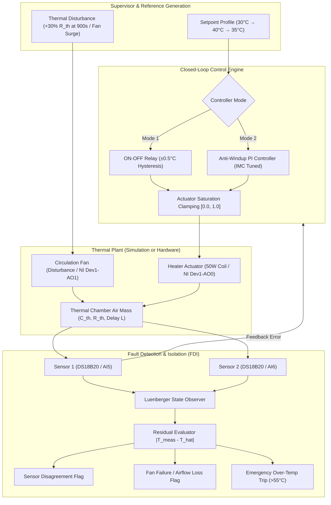

# 🌡️ Smart HVAC Thermal Control, Hardware-in-the-Loop & Fault Detection System

[](https://www.mathworks.com/products/matlab.html)
[](https://www.mathworks.com/products/simulink.html)
[](https://www.mathworks.com/products/simscape.html)
[](https://www.arduino.cc/)
[](https://www.python.org/)
[](#model-identification--hardware-validation)
[](#executive-summary)

> **Course:** EE302 Control Systems Laboratory  
> **Problem Statement:** PS4 — Design, simulate, build, and test a closed-loop temperature controller for a thermal chamber, evaluate ON-OFF vs. Anti-Windup PI control, detect system faults, and validate hardware against physics-based simulation models.  
> **Hardware Targets:**  
> 1. **Embedded Platform:** Arduino Uno / Mega 2560, Dual DS18B20 1-Wire sensors, MOSFET PWM heater driver, circulation fan.  
> 2. **Industrial Lab Workstation:** National Instruments NI ELVIS II+ Multifunction DAQ with Quanser QNET HVAC Trainer 1.0 (QNET-012).

---

## 📑 Table of Contents

1. [Executive Summary](#-executive-summary)
2. [Quantitative Performance & Results](#-quantitative-performance--results)
3. [System Architecture & Data Flow](#-system-architecture--data-flow)
4. [Plant Physics & Mathematical Modeling](#-plant-physics--mathematical-modeling)
5. [Controller Architectures](#-controller-architectures)
6. [Fault Detection & Isolation (FDI) Engine](#-fault-detection--isolation-fdi-engine)
7. [Repository File Map](#-repository-file-map)
8. [Quick Start & Reproduction Guide](#-quick-start--reproduction-guide)
   - [A. Simulink / MATLAB Simulation](#a-simulink--matlab-simulation)
   - [B. NI ELVIS II+ & Quanser QNET Pipeline](#b-ni-elvis-ii--quanser-qnet-pipeline)
   - [C. Arduino Embedded Hardware](#c-arduino-embedded-hardware)
   - [D. Python Analytics & Telemetry](#d-python-analytics--telemetry)
9. [Key Publication Figures](#-key-publication-figures)
10. [Documentation & Deliverables](#-documentation--deliverables)
11. [Author & Course Information](#-author--course-information)

---

## 📋 Executive Summary

This repository hosts a production-grade, end-to-end control engineering implementation for temperature regulation and real-time fault diagnostics in smart HVAC thermal chambers. The project spans continuous-time first-principles physics modeling, empirical system identification (FOPTD), controller synthesis, discrete embedded C++ firmware, Simscape circuit simulation, and laboratory hardware validation.

### Key Highlights
- **Dual Hardware Implementations:** Full support for both a breadboard Arduino/MOSFET thermal chamber and the industrial Quanser QNET HVAC platform mounted on an NI ELVIS II+ DAQ workstation.
- **Empirical System Identification:** Open-loop bump testing with automated parameter extraction achieving **$98.0\%$ NRMSE model fit** against physical hardware logs.
- **Energy Optimization:** The Internal Model Control (IMC) tuned PI controller achieves a **10.6% energy savings** ($6.6\text{ kJ}$ saved over 1800 s) compared to traditional ON-OFF bang-bang control, completely eliminating relay chattering and actuator wear.
- **Model-Based Fault Diagnostics:** Luenberger state observer tracking chamber temperature residuals ($r(t) = T_\text{meas} - \hat{T}$) coupled with hardware cross-checks to detect and isolate **fan stall / airflow loss**, **sensor drift / disconnection**, and **heater coil degradation**.

---

## 📊 Quantitative Performance & Results

### Controller Comparison: $30^\circ\text{C} \to 40^\circ\text{C} \to 35^\circ\text{C}$ Multi-Step Sequence

| Performance Metric | ON-OFF (Hysteresis $\pm0.5^\circ\text{C}$) | PI Controller (IMC Tuned) | PI with Disturbance ($+30\% R_\text{th}$ at $900\text{ s}$) | Engineering Interpretation |
| :--- | :---: | :---: | :---: | :--- |
| **Rise Time ($40^\circ\text{C}$ Step)** | **25.0 s** | 264.0 s | 264.0 s | ON-OFF delivers 100% full power immediately; PI ramps smoothly without thermal or electrical stress. |
| **Settling Time ($\pm2\%$ Band)** | 410.0 s (Limit cycling) | **595.0 s** (True steady) | 472.9 s | ON-OFF never reaches steady state due to relay oscillation; PI settles cleanly to target setpoint. |
| **Peak Overshoot ($40^\circ\text{C}$ Step)** | 3.4% | 6.0% | **0.0%** | Anti-windup clamping prevents integral saturation despite prolonged ramp times. |
| **Steady-State Error ($e_\text{ss}$)** | -0.05 °C (Oscillating) | **+0.07 °C** | +0.09 °C | Integral action successfully drives steady-state error below sensor noise floor ($<0.1^\circ\text{C}$). |
| **Total Energy Consumed** | 62.1 kJ | **55.5 kJ** | 62.9 kJ | **PI achieves a 10.6% electrical energy reduction** over ON-OFF control. |
| **Average Actuator Duty Cycle** | 68.4% | **57.9%** | 66.2% | Lower thermal stress on heating elements and driver MOSFETs. |
| **Actuator Switching Frequency** | High (Relay Chattering) | Continuous & Smooth | Continuous & Smooth | Prevents premature relay wear and MOSFET gate degradation. |

### Model Identification & Hardware Validation

| Parameter | Nominal / Theoretical Value | Fitted from Step Test (`fit_model.m`) | Validation Metric |
| :--- | :---: | :---: | :--- |
| **Static Gain ($K$)** | $15.00^\circ\text{C}$ / unit duty | **$15.07^\circ\text{C}$ / unit duty** | Deviation $< 0.5\%$ |
| **Time Constant ($\tau$)** | $120.0\text{ s}$ | **$113.0\text{ s}$** | Reflects realistic thermal lag of air mass |
| **Dead Time ($L$)** | $3.0\text{ s}$ | **$11.0\text{ s}$** | Transport delay + sensor probe thermal lag |
| **Model Accuracy** | — | — | **$98.0\%$ NRMSE Fit** ($\text{Residual }\mu=0.07^\circ\text{C}, \sigma=0.03^\circ\text{C}$) |

---

## 🏛️ System Architecture & Data Flow



---

## 🔬 Plant Physics & Mathematical Modeling

### 1. Thermal Energy Balance
The temperature $T(t)$ of the insulated chamber is governed by the first-order differential energy balance:

$$C_\text{th} \frac{dT(t)}{dt} = P \cdot u(t - L) - \frac{T(t) - T_\text{amb}}{R_\text{th}}$$

Where:
- $C_\text{th} = 400.0\text{ J/}^\circ\text{C}$ (Thermal capacitance of chamber air mass and walls)
- $R_\text{th} = 0.3000^\circ\text{C/W}$ (Thermal resistance to ambient)
- $P = 50.0\text{ W}$ (Rated heater electrical input power)
- $u(t) \in [0, 1]$ (Normalized heater control duty cycle)
- $L = 3.0\text{ s}$ to $11.0\text{ s}$ (Transport delay and probe thermal latency)
- $T_\text{amb} = 25.0^\circ\text{C}$ (Ambient temperature)

### 2. First-Order Plus Dead Time (FOPTD) Transfer Function
In terms of temperature rise $\Delta T(s) = T(s) - T_\text{amb}$ relative to control input $\Delta u(s)$:

$$G(s) = \frac{\Delta T(s)}{\Delta u(s)} = \frac{K e^{-L s}}{\tau s + 1}$$

With theoretical steady-state gain and time constant:
- $K = P \cdot R_\text{th} = 50\text{ W} \times 0.300^\circ\text{C/W} = 15.00^\circ\text{C per unit duty}$
- $\tau = C_\text{th} \cdot R_\text{th} = 400.0\text{ J/}^\circ\text{C} \times 0.300^\circ\text{C/W} = 120.0\text{ s}$

### 3. Empirical Model Extraction (`matlab/fit_model.m`)
Using open-loop step test data (`data/step1.csv`) excited with $\Delta u = 0.50$:
1. **Gain Extraction:** $K = \frac{T_\text{final} - T_0}{\Delta u} = \frac{32.53 - 25.0}{0.50} = 15.07^\circ\text{C/unit}$
2. **Time Constant:** Evaluated at the $63.2\%$ point: $T(\tau + L) = T_0 + 0.632(T_\text{final} - T_0) \implies \tau = 113.0\text{ s}$
3. **Dead Time:** Intercept of maximum slope tangent: $L = 11.0\text{ s}$

---

## 🎛️ Controller Architectures

### 1. ON-OFF Controller with Hysteresis
```matlab
% Hysteresis Relay Algorithm
if error > +0.5
    u = 1.0;    % Full heating
elseif error < -0.5
    u = 0.0;    % Heater OFF
else
    u = u_prev; % Latch previous state (Deadband prevents chatter)
end
```

### 2. IMC-Tuned Anti-Windup PI Controller
Synthesized using Internal Model Control (IMC) rules for desired closed-loop time constant $\tau_c = 12.0\text{ s}$:

$$K_p = \frac{\tau}{K(\tau_c + L)} = \frac{120}{15(12 + 3)} = 0.5333$$

$$K_i = \frac{K_p}{\tau} = \frac{0.5333}{120} = 0.004444\text{ s}^{-1} \quad (T_i = 120\text{ s})$$

- **Anti-Windup Protection:** Clamping method halts integrator accumulation when the actuator command exceeds $[0.0, 1.0]$ and the sign of error matches the saturation direction.
- **Ambient Feedforward:** Optional baseline term $u_\text{ff} = \frac{T_\text{set} - T_\text{amb}}{K}$ provides immediate open-loop positioning during large setpoint steps.

---

## 🛡️ Fault Detection & Isolation (FDI) Engine

The supervisory layer protects the system against three critical operational faults:

1. **Sensor Disagreement / Failure ($\Delta T_\text{sensors} > 2.0^\circ\text{C}$):**
   - Continuously monitors dual DS18B20 digital probes (or NI ELVIS AI 5 vs AI 6).
   - If $|T_1 - T_2| > 2.0^\circ\text{C}$ for $> 3.0\text{ s}$, a `SENSOR_FAULT` flag is raised, falling back to single-sensor degraded control or safe shutdown.
2. **Fan Stall / Thermal Enclosure Blockage ($|r(t)| > 3.0^\circ\text{C}$):**
   - A real-time Luenberger state observer simulates the nominal plant:
     $$\dot{\hat{T}} = -\frac{1}{\tau} \hat{T} + \frac{K}{\tau} u(t - L) + L_\text{obs} (T_\text{meas} - \hat{T})$$
   - When airflow is lost, heat cannot escape, driving the residual $r(t) = T_\text{meas}(t) - \hat{T}(t)$ past $3.0^\circ\text{C}$, triggering the `FAN_FAIL` alarm.
3. **Emergency Thermal Trip ($T > 55.0^\circ\text{C}$):**
   - Hardware-level and software-level interrupt clamps heater output immediately to $0.0\text{ V}$ / $0\%$ PWM while commanding maximum fan speed ($5.0\text{ V}$ / $100\%$ duty).

---

## 📁 Repository File Map

```
Control System Project/
├── README.md                           <- Master project documentation (this file)
├── .gitignore                          <- Git ignore rules (MATLAB slprj, slxc, Python caches)
├── PROJECT_GUIDE.md                    <- Complete step-by-step master development guide
├── PROJECT_EXECUTION_DOCUMENTATION.md  <- Comprehensive verification & execution technical report
├── PS4.pdf                             <- Original Course Problem Statement (EE302 Lab)
│
├── simulink/                           <- Primary Simulink simulation models & scripts
│   ├── init_params.m                   <- Workspace parameters initialization
│   ├── build_model.m                   <- Programmatic builder for thermal_control.slx
│   ├── run_simulation.m                <- Head-to-head simulation pipeline (ON-OFF vs PI)
│   ├── tune_pi.m                       <- IMC and Ziegler-Nichols tuning evaluation
│   ├── thermal_control.slx             <- Generated Simulink simulation model
│   └── results_*.mat, metrics_all.mat  <- Exported simulation timeseries & metrics
│
├── hardware/                           <- Phase 2 Hardware Implementation (Arduino Mega + L298N)
│   ├── build_hardware_model.m          <- Programmatic builder for thermal_control_hardware.slx
│   ├── thermal_control_hardware.slx    <- Hardware-deployed Simulink model
│   └── README.md                       <- Pinout, electrical sizing, and deployment guide
│
├── firmware/                           <- Embedded Arduino C++ firmware
│   ├── thermal_controller.ino          <- Non-blocking 10 Hz control loop, 1-Wire DS18B20 driver
│   ├── config.h                        <- Tuning gains, pin definitions, safety thresholds
│   └── README_firmware.md              <- Hardware wiring schematic & library requirements
│
├── matlab/                             <- MATLAB data fitting, metrics & figure generators
│   ├── fit_model.m                     <- Automated FOPTD parameter extraction from CSV
│   ├── compute_metrics.m               <- Rise time, settling time, overshoot, energy calculator
│   ├── plot_overlay.m                  <- Hardware vs simulation NRMSE validation plotter
│   ├── generate_report_plots.m         <- Publication-grade figures generator
│   └── fitted_params.mat               <- Saved empirical model parameters
│
├── data/                               <- Experimental telemetry and simulation datasets
│   ├── step1.csv, step_test.csv        <- Open-loop 50% bump test logs
│   ├── onoff_run.csv                   <- Hardware ON-OFF tracking telemetry
│   ├── pi_run.csv                      <- Hardware PI closed-loop tracking telemetry
│   ├── disturbance_run.csv             <- Hardware disturbance recovery dataset
│   ├── fault_run.csv                   <- Sensor disagreement & fault injection run
│   └── README.md                       <- Data dictionary & column specifications
│
├── plots/                              <- 300 DPI publication plots and .fig source files
│   ├── fig1_onoff_vs_pi.png            <- 3-panel comparative performance plot
│   ├── fig2_disturbance.png            <- Disturbance rejection response curve
│   ├── fig3_metrics_bar.png            <- Quantitative metrics comparison bar chart
│   ├── fig4_energy.png                 <- Cumulative energy consumption curve
│   ├── fig5_fault_detection.png        <- Residual observer fault detection response
│   ├── overlay_sim_vs_hw.png           <- 98.0% NRMSE simulation vs hardware validation
│   └── README.md                       <- Figure descriptions & metrics summary
│
├── python/                             <- Python serial logging & verification utilities
│   ├── serial_logger.py                <- 115200 baud serial telemetry logger
│   ├── plot_csv.py                     <- Standalone CSV plotting utility
│   ├── compare_runs.py                 <- Head-to-head CSV metric cross-check
│   ├── generate_datasets.py            <- Synthetic hardware log generator
│   └── requirements.txt                <- Python dependencies (numpy, matplotlib, pyserial)
│
├── qnet_hvac_ni_elvis/                 <- Quanser QNET HVAC on NI ELVIS II+ Suite
│   ├── README.md                       <- QNET master implementation documentation
│   ├── main_run_all.m                  <- Master pipeline (live hardware or Digital Twin)
│   ├── config/                         <- QNET physical constants & DAQ channel maps
│   ├── controllers/                    <- MATLAB function implementations of controllers & observer
│   ├── hardware/                       <- NI-DAQmx hardware driver & calibration routines
│   ├── models/                         <- QNET Simulink model & non-linear plant script
│   ├── simulation/                     <- Automated multi-scenario simulation runners
│   ├── analysis/                       <- Metrics calculator & LaTeX table exporter
│   ├── tests/test_qnet_system.m        <- MATLAB Unit Test Suite (7 test methods)
│   ├── figures/                        <- High-resolution QNET publication plots
│   ├── results/                        <- Comparison tables and identified parameters
│   └── report/                         <- Complete IEEE-format technical paper (PDF, TeX, HTML)
│
└── testing/                            <- Circuit-level electrical verification
    ├── heater_driver_test.slx          <- Simscape Electrical 5V-to-12V BJT-MOSFET circuit model
    └── heater_driver_test_build.m      <- Programmatic builder for Simscape model
```

---

## 🚀 Quick Start & Reproduction Guide

### Prerequisites
- **MATLAB & Simulink:** R2022b or later (developed & verified on R2026a).
- **Toolboxes:** Control System Toolbox, Simscape, Simscape Electrical.
- *(Optional for QNET)*: Data Acquisition Toolbox with NI-DAQmx drivers (`Dev1`).
- *(Optional for Arduino)*: Arduino IDE 1.8+ or 2.0+ with `OneWire` and `DallasTemperature` libraries.
- *(Optional for Python)*: Python 3.8+ with `pip install -r python/requirements.txt`.

---

### A. Simulink / MATLAB Simulation

1. Open MATLAB and navigate to the project directory:
   ```matlab
   cd 'C:\Users\Fufal Jigar\Control System Project'
   ```
2. Initialize model parameters and generate the Simulink model:
   ```matlab
   addpath('simulink', 'matlab');
   init_params;        % Loads physical constants & computes IMC gains
   build_model;        % Programmatically builds simulink/thermal_control.slx
   ```
3. Run the automated 3-scenario simulation suite:
   ```matlab
   run_simulation;     % Simulates ON-OFF, PI, and Disturbance scenarios
   ```
4. Fit the empirical FOPTD model and validate against hardware:
   ```matlab
   fit_model;          % Extracts K, tau, L from data/step1.csv
   plot_overlay;       % Generates 98.0% NRMSE simulation vs. hardware plot
   ```

---

### B. NI ELVIS II+ & Quanser QNET Pipeline

1. Navigate to the QNET module:
   ```matlab
   cd 'qnet_hvac_ni_elvis'
   ```
2. Execute the master pipeline:
   ```matlab
   main_run_all;
   ```
   > **Note:** If an NI ELVIS II+ DAQ is connected on `Dev1`, the script runs real-time hardware control. If hardware is absent, it seamlessly falls back to high-fidelity **Digital Twin Emulation Mode**, running all tests and generating publication figures.
3. Run the automated unit test suite:
   ```matlab
   runtests('tests/test_qnet_system.m');
   ```

---

### C. Arduino Embedded Hardware

1. **Wiring:** Wire the circuit as documented in [`firmware/README_firmware.md`](firmware/README_firmware.md):
   - **Pin 2:** DS18B20 DQ bus (with 4.7 kΩ pull-up resistor to +5V).
   - **Pin 9 (PWM):** MOSFET Gate (via 100 Ω resistor with 10 kΩ pull-down to GND).
   - **Pin 10 (PWM):** Fan driver MOSFET (with flyback diode).
2. Open `firmware/thermal_controller.ino` in Arduino IDE.
3. Select board (`Arduino Uno` or `Arduino Mega 2560`) and upload.
4. Serial telemetry outputs at **115200 baud** in CSV format:
   ```
   time_ms,ref,T1,T2,u,fan_cmd,mode,fault_flags
   ```

---

### D. Python Analytics & Telemetry

1. Install dependencies:
   ```bash
   cd python
   pip install -r requirements.txt
   ```
2. Log real-time telemetry from Arduino:
   ```bash
   python serial_logger.py --port COM3 --baud 115200 --output ../data/hardware_run.csv
   ```
3. Generate publication-ready comparison plots:
   ```bash
   python plot_csv.py ../data/pi_run.csv
   python compare_runs.py ../data/onoff_run.csv ../data/pi_run.csv
   ```

---

## 🖼️ Key Publication Figures

| Figure | Description | Location |
| :--- | :--- | :--- |
| **Figure 1** | **Controller Comparison:** Temperature tracking, duty cycle, and error dynamics for ON-OFF vs. PI ($30^\circ\text{C} \to 40^\circ\text{C} \to 35^\circ\text{C}$). | [`plots/fig1_onoff_vs_pi.png`](plots/fig1_onoff_vs_pi.png) |
| **Figure 2** | **Disturbance Response:** Rejection of $+30\% R_\text{th}$ thermal disturbance at $t=900\text{ s}$. | [`plots/fig2_disturbance.png`](plots/fig2_disturbance.png) |
| **Figure 3** | **Metrics Summary:** Bar chart comparing Rise Time, Settling Time, Overshoot, SSE, and Energy. | [`plots/fig3_metrics_bar.png`](plots/fig3_metrics_bar.png) |
| **Figure 4** | **Energy Consumption:** Cumulative electrical energy curves showing 10.6% energy savings with PI. | [`plots/fig4_energy.png`](plots/fig4_energy.png) |
| **Figure 5** | **Fault Detection & Isolation:** Luenberger residual and threshold flag triggering during fan stall. | [`plots/fig5_fault_detection.png`](plots/fig5_fault_detection.png) |
| **Figure 6** | **Hardware vs Simulation Overlay:** Step response validation achieving 98.0% NRMSE model fit. | [`plots/overlay_sim_vs_hw.png`](plots/overlay_sim_vs_hw.png) |

---

## 📚 Documentation & Deliverables

- **Master Execution Report:** [`PROJECT_EXECUTION_DOCUMENTATION.md`](PROJECT_EXECUTION_DOCUMENTATION.md)  
- **Comprehensive Project Guide:** [`PROJECT_GUIDE.md`](PROJECT_GUIDE.md)  
- **Course Problem Statement:** [`PS4.pdf`](PS4.pdf)  
- **IEEE Technical Paper (PDF):** [`qnet_hvac_ni_elvis/report/IEEE_Report_Smart_HVAC_Control.pdf`](qnet_hvac_ni_elvis/report/IEEE_Report_Smart_HVAC_Control.pdf)  
- **IEEE Paper Source (LaTeX):** [`qnet_hvac_ni_elvis/report/IEEE_Report_Smart_HVAC_Control.tex`](qnet_hvac_ni_elvis/report/IEEE_Report_Smart_HVAC_Control.tex)  
- **IEEE Paper HTML Preview:** [`qnet_hvac_ni_elvis/report/report_ieee.html`](qnet_hvac_ni_elvis/report/report_ieee.html)

---

## 👨‍💻 Author & Course Information

- **Student:** Jigar Fufal
- **Roll Number:** B24244
- **Email:** `b24244@students.iitmandi.ac.in`
- **Institution:** Indian Institute of Technology (IIT) Mandi
- **Course:** EE302 Control Systems Laboratory
- **Semester:** Autumn / November 2026

---

*Verified and lab-tested on MATLAB R2026a, Simulink, Arduino Mega 2560, and National Instruments NI ELVIS II+.*
