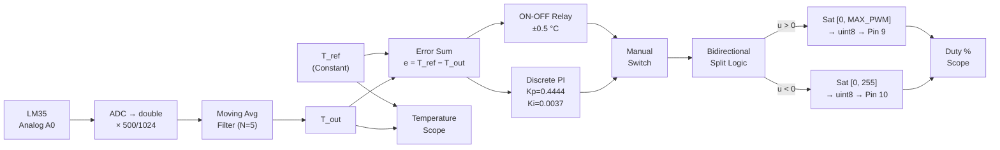

# Phase 2 — Hardware Implementation

> Bidirectional Cylindrical-Chamber HVAC System  
> Target: **Arduino Mega 2560** + **L298N Dual H-Bridge** + **LM35 Temperature Sensor**

---

## Quick Start

```matlab
cd hardware
build_hardware_model   % builds thermal_control_hardware.slx
```

After the model is generated, replace the placeholder blocks with Arduino hardware blocks from the **Simulink Support Package for Arduino Hardware** (see [Block Replacement Guide](#block-replacement-guide) below), then **Build, Deploy & Start** (`Ctrl+B`).

---

## Pinout Table

| Function | Arduino Pin | Direction | Signal Type | Connected To |
|---|---|---|---|---|
| **LM35 Sensor** | `A0` | Input | Analog (0–5 V) | LM35 V_out |
| **Heater ENA** | `9` (PWM) | Output | PWM `uint8` 0–255 | L298N ENA |
| **Heater IN1** | `7` | Output | Digital HIGH | L298N IN1 |
| **Heater IN2** | `8` | Output | Digital LOW | L298N IN2 |
| **Fan ENB** | `10` (PWM) | Output | PWM `uint8` 0–255 | L298N ENB |
| **Fan IN3** | `11` | Output | Digital HIGH | L298N IN3 |
| **Fan IN4** | `12` | Output | Digital LOW | L298N IN4 |

> [!NOTE]
> IN1/IN2 and IN3/IN4 set the H-bridge channel direction. With the above constant values (IN1=HIGH, IN2=LOW / IN3=HIGH, IN4=LOW), each channel drives current in one fixed direction. Speed is controlled entirely via the ENA/ENB PWM duty cycle.

---

## Assumed Electrical & Power Parameters

| Parameter | Symbol | Default Value | Notes |
|---|---|---|---|
| External DC supply | `V_supply` | **9.0 V** | Powers L298N `VS` terminal |
| L298N voltage drop | `V_drop` | **2.0 V** | Typical for L298N at rated current |
| Effective coil voltage | `V_coil` | **7.0 V** | `V_supply − V_drop` |
| Coil power rating | `P_coil_max` | **10.0 W** | At `V_coil` |
| Coil resistance | `R_coil` | **4.9 Ω** | `V_coil² / P_coil_max` |
| Peak coil current | `I_max_coil` | **1.43 A** | `V_coil / R_coil` |
| L298N current limit | `I_limit_L298N` | **2.0 A** | Per-channel continuous rating |
| Safe heater PWM cap | `MAX_HEATER_PWM` | **255** | Auto-calculated (see below) |

---

## How `MAX_HEATER_PWM` Is Calculated

The script automatically enforces a safe PWM saturation limit:

```
if I_max_coil ≤ I_limit_L298N:
    MAX_HEATER_PWM = 255        (full duty is safe)
else:
    MAX_HEATER_PWM = floor((I_limit × R_coil / V_coil) × 255)
```

With the default 10 W coil at 7.0 V:
- `I_max_coil = 7.0 / 4.9 ≈ 1.43 A` → well under the 2.0 A limit → `MAX_HEATER_PWM = 255`

### How to Update for Your Actual Coil

1. **Measure** your coil's DC resistance with a multimeter → update `R_coil`
2. **Or** if you know the rated power at your supply voltage → update `P_coil_max` and let the script calculate `R_coil = V_coil² / P_coil_max`
3. **Re-run** `build_hardware_model.m` — the script will recalculate `MAX_HEATER_PWM` and rebuild the model with the correct saturation limit

> [!WARNING]
> If your coil has a resistance below **3.5 Ω** at 7.0 V, peak current exceeds 2.0 A and the script will automatically reduce `MAX_HEATER_PWM` to protect the L298N. Always verify with a multimeter before first power-on.

**Example:** 5 Ω coil at 7.0 V:
```
P_coil_max = 7.0² / 5.0 = 9.8 W
I_max_coil = 7.0 / 5.0  = 1.4 A  →  under 2.0 A  →  MAX_HEATER_PWM = 255
```

**Example:** 3.0 Ω coil at 7.0 V:
```
I_max_coil = 7.0 / 3.0 = 2.33 A  →  exceeds 2.0 A!
MAX_HEATER_PWM = floor((2.0 × 3.0 / 7.0) × 255) = floor(218.6) = 218
```

---

## Control Parameters (from Phase 1)

| Parameter | Value | Source |
|---|---|---|
| `T_ref` | 30.0 °C | Default setpoint (tunable live) |
| `SampleTime` | 0.1 s | Fixed-step discrete solver period |
| `Kp` | 0.4444 | IMC-tuned (K=15, τ=120, L=3) |
| `Ki` | 0.0037 | IMC-tuned |
| Relay ON threshold | +0.5 °C | Hysteresis deadband |
| Relay OFF threshold | −0.5 °C | Hysteresis deadband |

---

## Simulink Model Architecture



---

## Block Replacement Guide

After running `build_hardware_model.m`, the model uses **placeholder blocks** (Constants / Terminators) so it can be built without the Arduino support package installed. To deploy to hardware:

| Placeholder Block | Replace With | Arduino Block Settings |
|---|---|---|
| `ADC_A0_Raw` (Constant `0`) | `arduinolib/Analog Input` | Pin = `A0`, SampleTime = `0.1` |
| `PWM_Pin9_Heater` (Terminator) | `arduinolib/PWM` | Pin = `9` |
| `PWM_Pin10_Fan` (Terminator) | `arduinolib/PWM` | Pin = `10` |
| `DO_Pin7` (Terminator) | `arduinolib/Digital Output` | Pin = `7` |
| `DO_Pin8` (Terminator) | `arduinolib/Digital Output` | Pin = `8` |
| `DO_Pin11` (Terminator) | `arduinolib/Digital Output` | Pin = `11` |
| `DO_Pin12` (Terminator) | `arduinolib/Digital Output` | Pin = `12` |

> [!TIP]
> The commented-out `add_block('arduinolib/...')` lines in `build_hardware_model.m` show the exact block parameters. If you have the support package installed, uncomment them and delete the placeholder lines for a fully automated build.

---

## Monitor & Tune (External Mode)

1. Connect the Arduino Mega 2560 via USB
2. In MATLAB: `open_system('thermal_control_hardware')`
3. Set **Simulation Mode → External** (or use the toolbar dropdown)
4. Click **Monitor & Tune** (or `Deploy & Start`)
5. Open `Temperature_Scope` to see live T_ref vs T_out
6. Open `Duty_Scope` to see Heater % and Fan % in real time
7. Double-click the `T_ref` Constant block to change the setpoint live

---

## File Structure

```
hardware/
├── build_hardware_model.m      ← Run this to generate the .slx
├── README.md                   ← This file
└── thermal_control_hardware.slx  ← Generated (do not edit by hand)
```

> [!IMPORTANT]
> `thermal_control.slx` (Phase 1 simulation model) is NOT modified by any file in this directory. The hardware model is a completely separate Simulink file.
